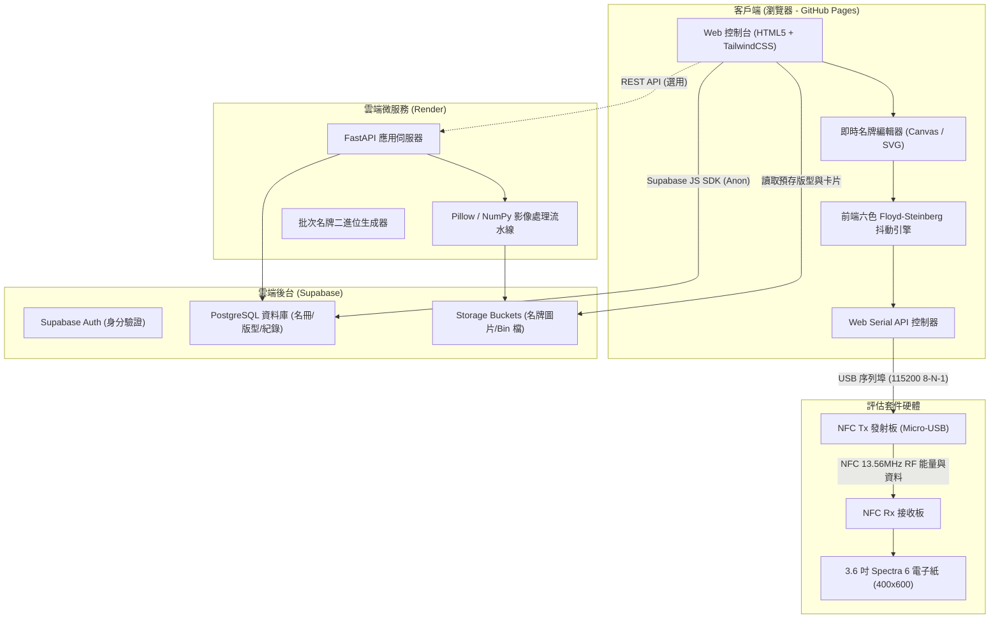

# Bagi 3.6” Spectra 6 系統整合架構書 (System Architecture)

---

## 1. 系統整體拓撲圖 (Overall System Topology)

本系統以雲端一體化與邊緣直連為設計理念，架構圖如下：

---

## 2. GitHub Pages 前端直連設計 (Web Serial)

### 為什麼選擇 Web Serial API？
- **無需安裝驅動**：Windows 10/11 系統已原生自帶 STMicroelectronics USB VCP 驅動。
- **免桌面安裝包**：使用者打開 GitHub Pages 網址（支援 HTTPS 即可存取 Web Serial），插上 Tx 板點擊「連線」即可開始刷卡。
- **純客戶端離線運作**：內建 JavaScript 版 Floyd-Steinberg 抖動演算法與 4-bit 二進位封裝器，在沒有後端伺服器的情況下亦可單機完整運作。

---

## 3. Render 雲端伺服器角色 (Cloud Backend)

- **自動化批次生成**：針對大型會議或展覽，可上傳 Excel / CSV 嘉賓清單，由 Render 自動套版並批次產生數百張 120KB `.bin` 檔案。
- **進階影像增強**：針對非標準色彩圖片進行色域校正、飽和度提升、清晰度銳化後再進行 6 色抖動。
- **Render 免費/低成本佈署**：採用 Dockerfile 或 Python 原生環境，配置 `render.yaml` 實現一鍵 Blueprint 自動建置。

---

## 4. Supabase 雲端資料庫設計 (Supabase Backend)

- **PostgreSQL 資料表結構**：
  - `badges`：存放名牌資料（姓名、公司、職稱、QR Code 內容、預覽圖 URL、產生之 bin 檔 URL）。
  - `templates`：名牌樣式版型（背景圖、文字位置、字型大小、顏色對應）。
  - `events`：活動專案管理。
  - `transmission_logs`：刷卡傳輸稽核紀錄（裝置 COM Port、傳輸耗時、成功狀態）。
- **Storage Buckets**：
  - `badge-images`：儲存原始上傳圖檔與已抖動圖檔。
  - `badge-bins`：儲存已編譯好之 120,000 Bytes `.bin` 檔案，前端可直接 Fetch 並傳送。
