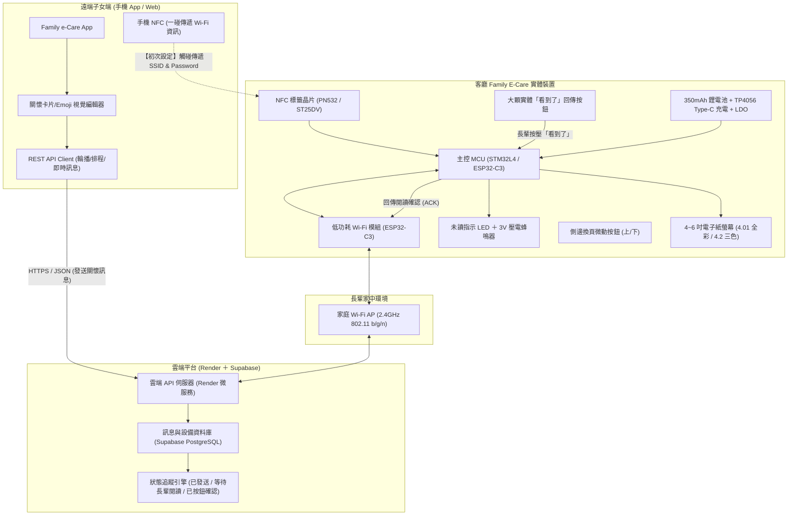

# Family E-Care — 系統整合架構書 (System Architecture)

---

## 1. 系統整體拓撲圖 (Overall System Topology)

Family E-Care 採用「**手機 App ＋ 雲端伺服器 ＋ 家用 Wi-Fi ＋ 裝置 Wi-Fi 模組**」架構，並以 **NFC 專責初次觸碰配對與快速配網**。



---

## 2. 通訊角色精準分工 (NFC vs. Wi-Fi)

| 通訊技術 | 角色定位 | 使用時機與傳輸內容 | 功耗考量 |
| :--- | :--- | :--- | :--- |
| **NFC (近場通訊)** | **設備初始化與快速配網** | • 新機拆箱或更換 Wi-Fi 時使用。<br>• 子女手機貼近裝置，透過 NDEF 寫入家用 Wi-Fi SSID 與密碼。<br>• **日常不參與遠端訊息傳輸**。 | 平時零功耗（無感應時不通電）。 |
| **Wi-Fi (802.11 b/g/n)** | **日常遠距訊息接收與確認回報** | • 裝置自 Deep Sleep 喚醒，連線至家庭路由器。<br>• 向雲端輪詢新訊息 (HTTP GET / MQTT)。<br>• 長輩按下「看到了」實體按鍵時，回傳確認狀態 (ACK)。 | 連網時 80~120mA，平時深度休眠 (<15µA)。 |

---

## 3. 350mAh 低功耗狀態機 (Power State Machine)

為了讓 350mAh 鋰聚合物電池達到 **30~45 天以上的持久續航**，韌體執行嚴格的事件驅動與深度睡眠排程：

```mermaid
stateDiagram-v2
    [*] --> DeepSleep: 開機初始化完成

    state DeepSleep {
        note right of DeepSleep: 靜態功耗 < 15µA\n關閉 Wi-Fi、螢幕與外設供電\n僅 RTC 保持計時
    }

    DeepSleep --> RTCWakeup: 每 5 分鐘 RTC 定時喚醒
    DeepSleep --> ButtonWakeup: 長輩按下實體按鈕 (外部 GPIO 中斷)

    state RTCWakeup {
        [*] --> ConnectWifi: 開啟 ESP32 Wi-Fi
        ConnectWifi --> CheckServer: 查詢雲端未讀訊息 (耗時約 1.5 秒)
        
        state "判斷是否有新訊息" as CheckResult <<choice>>
        CheckServer --> CheckResult
        
        CheckResult --> AlertMode: 【有新訊息】
        CheckResult --> GoSleep: 【無新訊息】
    }

    state AlertMode {
        note right of AlertMode: 1. 綠色/暖黃 LED 呼吸閃爍\n2. 壓電蜂鳴器發出可愛提示音一次\n3. 等待長輩按壓實體鍵
    }

    AlertMode --> ButtonWakeup: 長輩察覺並按下「看到了」按鈕

    state ButtonWakeup {
        [*] --> SendAck: 連線 Wi-Fi 回報長輩已閱讀
        SendAck --> RefreshEPD: 執行電子紙顆粒刷新 (約 3.8 秒)
        RefreshEPD --> ClearAlert: 熄滅 LED
        ClearAlert --> GoSleep: 準備休眠
    }

    GoSleep --> DeepSleep: 關閉所有外設進入深睡
```

---

## 4. 雲端資料庫與狀態追蹤 (Supabase & Render)

### 訊息生命週期狀態碼 (Message Lifecycle Status)
1. **`draft` (草稿)**：子女在 App 上編輯中。
2. **`queued` (已排程 / 待發送)**：到達指定排程時間前暫存。
3. **`server_received` (已推送至雲端)**：訊息已存入 Supabase，等待裝置連線獲取。
4. **`device_fetched` (裝置已抓取)**：裝置定時喚醒並下載訊息，此時觸發裝置 LED 呼吸閃爍與蜂鳴器。
5. **`read_acknowledged` (長輩已按鈕確認)**：長輩走近按下實體「**看到了**」大按鈕，螢幕完成刷新，裝置回報 ACK，子女端 App 顯示綠色已讀打勾標記！
