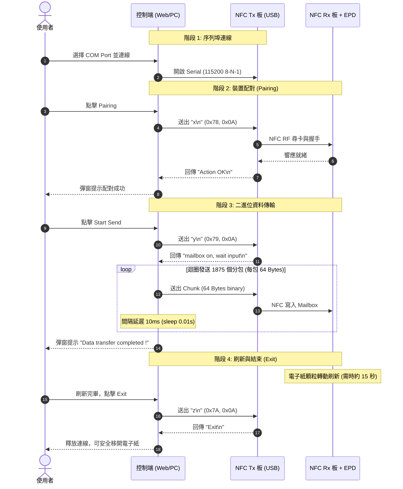

# ST_Badge.exe 逆向工程與完整通訊協定規範書 (Protocol Reverse Engineering)

---

## 1. 執行檔架構分析 (Executable Architecture)

透過二進位特徵分析與 CArchive TOC 解析，確認 `ST_Badge.exe` 之架構特徵如下：

- **封裝技術**：PyInstaller v2.1+ 打包框架。
- **執行環境**：Python 3.11 核心 (`cp311-win_amd64`)。
- **圖形使用者介面 (GUI)**：Python 原生 `tkinter` 與 `ttk` 模組，主視窗尺寸為 `850x600`。
- **序列通訊庫**：`pyserial` (`serial.tools.list_ports`)。
- **影像處理庫**：Pillow (PIL, `_imaging`, `Image`, `ImageTk`)。
- **主程式模組**：`ST_Badge.py` (反組譯提取出的核心邏輯檔案)。

---

## 2. 序列埠連線參數 (Serial Interface Parameters)

| 參數項目 | 設定數值 | 說明 |
| :--- | :--- | :--- |
| **Baud Rate (鮑率)** | `115200` | 標準傳輸速率 |
| **Data Bits (資料位元)** | `8` (EIGHTBITS) | 8 位元資料長度 |
| **Parity (同位檢查)** | `None` (PARITY_NONE) | 無同位檢查 |
| **Stop Bits (停止位元)** | `1` (STOPBITS_ONE) | 1 個停止位元 |
| **Read Timeout** | `1.0` 秒 | 讀取逾時 |
| **Write Timeout** | `5.0` 秒 | 寫入逾時 |

---

## 3. 雙向通訊協定流程 (Communication Protocol & Handshake)

整體通訊過程分為四大狀態階段：**連線 (Connect) ➔ 配對 (Pairing) ➔ 傳輸 (Data Transfer) ➔ 結束 (Exit)**。



---

## 4. 指令集詳解 (Command Set)

### (1) 配對指令：`x\n`
- **發送內容**：`ASCII "x\n"` (`0x78 0x0A`)
- **等待回覆**：字串中包含 `"Action OK"`
- **逾時時間**：3 秒
- **狀態處置**：
  - 若收到 `"Action OK"`，解鎖傳輸按鈕。
  - 若收到 `"Action Failed"` 或逾時，提示使用者重新對準天線。

### (2) 傳輸準備指令：`y\n`
- **發送內容**：`ASCII "y\n"` (`0x79 0x0A`)
- **等待回覆**：`"mailbox on, wait input"`
- **逾時時間**：10 秒
- **用途**：通知 Tx/Rx 開啟 NFC Mailbox 緩衝區，準備接收連續資料串流。

### (3) 分包資料傳輸 (Binary Data Stream)
- **總長度**：`120,000` 位元組。
- **分包大小**：`64` 位元組 (`chunk_size = 64`)。
- **分包總數**：$\frac{120,000}{64} = 1,875$ 個封包。
- **傳輸間隔**：每包寫入後休眠 `10 ms` (`time.sleep(0.01)`)。
- **容錯重試**：若遭遇 `SerialTimeoutException`，最多自動重試 3 次。

### (4) 結束釋放指令：`z\n`
- **發送內容**：`ASCII "z\n"` (`0x7A 0x0A`)
- **等待回覆**：字串中包含 `"Exit"`
- **逾時時間**：3 秒
- **用途**：關閉 Mailbox，釋放射頻通訊工作階段。

---

## 5. 影像轉換演算法還原 (Image Conversion Logic)

由反組譯 `EL040EF1_pic_to_bin_data` 還原之 Python 核心邏輯如下：

```python
# -*- coding: utf-8 -*-
from PIL import Image

def convert_image_to_epd_bin(image_path: str) -> bytes:
    # 1. 載入圖片並進行 180 度旋轉（以匹配硬體擺放方向）
    img = Image.open(image_path)
    img = img.rotate(180)
    rgb_img = img.convert("RGB")
    
    width, height = rgb_img.size
    assert (width, height) == (400, 600), f"圖片尺寸必須為 400x600，目前為 {width}x{height}"
    
    # 2. 六色映射對照表 (RGB 均為 0 或 255 的抖動圖片)
    color_map = {
        (0, 0, 0): 0x0,        # 黑色
        (255, 255, 255): 0x1,  # 白色
        (255, 255, 0): 0x2,    # 黃色
        (255, 0, 0): 0x3,      # 紅色
        (0, 0, 255): 0x5,      # 藍色
        (0, 255, 0): 0x6       # 綠色
    }
    
    pixel_nibbles = []
    for y in range(height):
        for x in range(width):
            rgb = rgb_img.getpixel((x, y))
            # 尋找最近或精確匹配色彩
            nibble = color_map.get(rgb, 0x1) # 預設回退白色
            pixel_nibbles.append(nibble)
            
    # 3. 每兩個像素 (4-bit + 4-bit) 打包為 1 個 Byte
    bin_bytes = bytearray()
    for i in range(0, len(pixel_nibbles), 2):
        byte_val = (pixel_nibbles[i] << 4) | pixel_nibbles[i + 1]
        bin_bytes.append(byte_val)
        
    return bytes(bin_bytes) # 總長度精確為 120,000 Bytes
```
